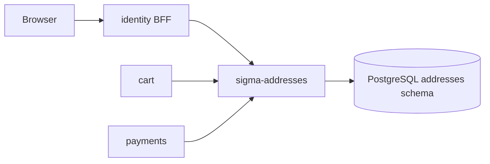

# sigma-addresses architecture

`sigma-addresses` stores billing and shipping addresses for Sigma Tactical Group identity users. Browsers reach it through the identity BFF; peer services read addresses over the internal JSON API.

## Context

This service owns the PostgreSQL `addresses` schema and the `addresses.addresses` table.

## Runtime shape

The `sigma-addresses` binary validates configuration, connects `AddressStore` to PostgreSQL, then hands `sigma_addresses::routes(store)` to `sigma_theme::warp::serve`. The theme crate supplies the Warp server, shared static assets, security headers, health integration, and the listen address from `PORT`.

Every browser page checks the shopper's identity session through the internal identity URL before rendering. The internal API is gated by `SIGMA_INTERNAL_TOKEN`.

## Request flow

`routes()` combines session-gated web routes from `web.rs` with internal JSON handlers from `api.rs`. `sigma_theme::warp::site_routes` supplies `/up`, static assets, and error recovery; health routes report database connectivity.

Web routes list, create, edit, delete, and set default addresses per category. Unauthenticated requests redirect to identity login. The internal API serves `GET /api/users/{user_id}/addresses` (optional `category` filter) and `GET /api/users/{user_id}/addresses/{id}`.

## Code map

| Path | Responsibility |
| --- | --- |
| `src/main.rs` | Validates config, connects the store, and starts the server. |
| `src/lib.rs` | Assembles web UI, internal API, health, theme, and CSP routes. |
| `src/config.rs` | Reads public URLs, identity internal URL, and optional cart badge URL. |
| `src/store.rs` | Per-user address CRUD and default enforcement. |
| `src/model/` | Address types and categories. |
| `src/web.rs` | Session-gated HTML UI. |
| `src/api.rs` | Internal-token JSON API. |
| `src/templates/` | Askama forms and list pages. |

## Data

PostgreSQL schema `addresses` holds one row per saved address keyed by `user_id`. A partial unique index enforces one default per `(user_id, category)`. Other users' address IDs return `404`, not `403`.

## Configuration

| Environment variable | Purpose |
| --- | --- |
| `PORT` | Listen port supplied to the theme crate. |
| `ADDRESSES_PUBLIC_BASE_URL` | Canonical public URL of this service (sign-in return links). |
| `ADDRESSES_IDENTITY_PUBLIC_URL` | Identity BFF URL for browser session checks and navbar links. |
| `ADDRESSES_CONTACT_PUBLIC_URL` | Contact-service URL for the shared chrome. |
| `ADDRESSES_CART_PUBLIC_URL` | Cart-service URL for the shared chrome. |
| `ADDRESSES_IDENTITY_INTERNAL_URL` | Cluster-internal identity URL for session status checks; falls back to the public URL in local dev. |
| `ADDRESSES_CART_BASE_URL` | Optional internal cart URL for the navbar item-count badge. |
| `DATABASE_URL` | PostgreSQL connection URL for the shared Sigma database. |

## Deployment

`Dockerfile` produces the `sigma-addresses` image. The platform deployment is at `../platform/services/addresses/base/deployment.yaml`; it exposes container port `8080` through `../platform/services/addresses/base/service.yaml` on service port `80`.

The public VirtualService and environment overlays reside beside the base manifests under `../platform/services/addresses/`. Production hostname and platform context are documented in [`../platform/README.md`](../platform/README.md).

## Testing

Run `cargo test -p sigma-addresses`. Integration tests in `src/lib.rs` cover `/up`, unauthenticated redirect to login, and internal API token enforcement. Tests use `sigma_pg::test_helpers::ready_store`.

## Design notes

- End-user UI only; there is no cross-user admin view.
- Billing and shipping categories share one table with category-scoped defaults.
- Navbar chrome comes from `sigma-identity-nav`.
